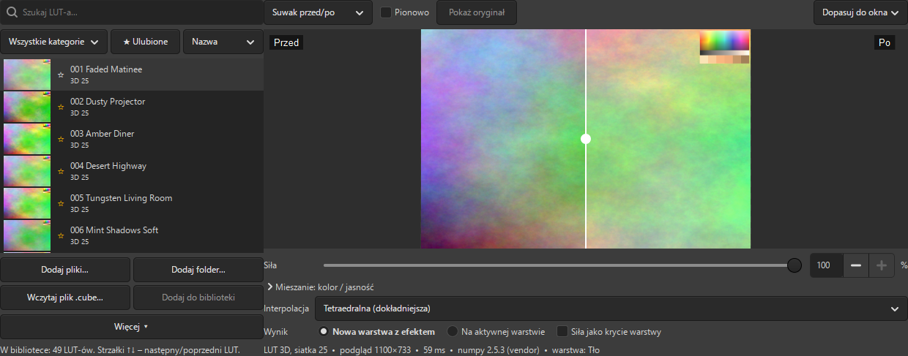
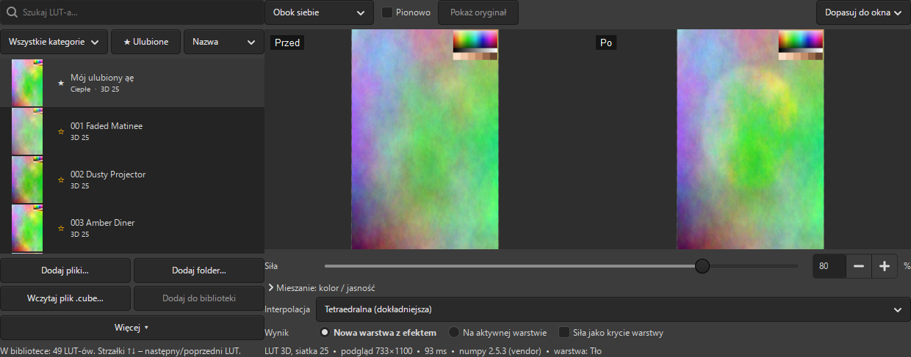

# LUTs (.cube) – GIMP 3 plug-in

*[Polski](README.md)*

A free, open-source (GPL-3.0) plug-in that applies color lookup tables in **`.cube`, `.3dl` and Hald CLUT (`.png`)** formats – the same LUTs you use in Lightroom, Photoshop or DaVinci Resolve. It has its own library of LUTs, a before/after preview with a split slider and an effect-strength slider. It works fully offline: no accounts, no API keys, no data collection.



**No LUTs are bundled.** The plug-in is a tool: you import `.cube` files (your own or purchased) from your disk.

Tested on GIMP 3.2.6 (Windows 11).

## Language

The interface is available in **Polish and English** and follows GIMP's interface language automatically (anything that is not Polish gets English). Force a language with the environment variable `GIMP_WTYCZKI_LANG=en` (or `pl`) before starting GIMP. GIMP caches the menu labels of plug-ins, so after switching the language reinstall the plug-ins (`install.ps1`) or touch the plug-in `.py` file so GIMP re-reads them; dialogs change immediately.

## Installation (Windows)

From an unpacked `lut-cube-vX.Y.Z.zip` (or from the repository folder `gimp-wtyczki`):

```powershell
powershell -ExecutionPolicy Bypass -File .\install.ps1 -Plugin lut-cube
```

The script finds the newest `%APPDATA%\GIMP\3.x` folder and copies the `lut-cube` folder to `plug-ins`. Restart GIMP afterwards. Menu: **Filters → LUT**.

Manually: copy the `lut-cube` folder so that the path becomes `%APPDATA%\GIMP\3.2\plug-ins\lut-cube\lut-cube.py` (the folder must have the same name as the file). Check the real location in GIMP: *Edit → Preferences → Folders → Plug-ins*.

### Fast variant (numpy)

The release package contains a `lut-cube\vendor` folder with numpy. With it a 24 MP photo takes about 4 s instead of about 70 s. If you install from the repository (there is no `vendor` folder there), add it with one command:

```powershell
powershell -ExecutionPolicy Bypass -File .\tools\fetch-numpy.ps1
```

Why not plain `pip install numpy`? GIMP on Windows ships its own Python 3.14 built in the MSYS2 CLANG64 environment. numpy wheels from PyPI are built for python.org's Python and will not load in it. The script therefore downloads ready-made MSYS2 packages (numpy 2.5.3 and OpenBLAS 0.3.34), verifies their SHA-256 sums and unpacks them to `vendor` (about 60 MB, BSD licenses in `vendor\licenses`). The plug-in loads this numpy only if it matches the Python version in GIMP; otherwise it falls back to the pure-Python variant.

Linux/macOS: `~/.config/GIMP/3.x/plug-ins/lut-cube/`, `lut-cube.py` must be executable. If GIMP's Python has numpy (system Python usually does) it is used automatically.

## Usage

1. Open a photo and select a layer in the Layers dialog.
2. **Filters → LUT → Apply LUT (.cube)…**
3. Pick a LUT from the list. The preview refreshes immediately and the **↑/↓ arrow keys** switch to the previous/next LUT.
4. Set the strength and click **Apply**.

Everything is **one undo step** (Ctrl+Z). For big photos a progress bar with a **Cancel** button is shown; cancelling leaves the image untouched.

All plug-in commands are in **Filters → LUT**:

| Command | Purpose |
|---|---|
| **Apply LUT (.cube)…** | the window with the library, preview and settings (described below) |
| **Manage library…** | the same window without an image: import and organize LUTs, preview on a built-in test picture (rainbow, grays, skin tones) |
| **Batch (photo folder)…** | the same LUT on all photos in a folder ([batch mode](#batch-mode)) |
| **Create Hald image (your own look)…** and **Save look as .cube…** | your own LUT from corrections made in GIMP ([your own look](#your-own-look-gimp-corrections-as-cube)) |

### Before/after preview

| Mode | Behavior |
|---|---|
| Before/after slider | left part is the original, right part the effect; drag the line with the mouse. *Vertical*: top/bottom |
| Side by side | two images next to each other (or one below the other) |
| Before/after toggle | one image; click the preview or the *Show original* button to toggle |
| LUT grid 2×2 / 3×3 | several LUTs from the list at once (the page with the selected LUT); clicking a tile selects the LUT, arrow keys page through |

**Holding the space bar** (when the preview or the list has focus) or the `\` key shows the original. On buttons and check boxes the space bar works normally. Zoom: *Fit to window* or *100 %* (a crop at full resolution, drag it to pan).

The preview is computed on a reduced copy (longer side 1100 px; 640 px without numpy) shortly after a slider change. It respects the selection, strength and blending.



### Strength and blending

- **Strength 0–100 %**: `result = original · (1 − s) + LUT(original) · s`, computed on perceptual values (like in Lightroom).
- **Blending: color / brightness** (collapsible): choose separately how much of the hue change and how much of the brightness change to take from the LUT. *Brightness 0 %* gives a pure color look without a contrast change; *Color 0 %* gives the tonal change only. The brightness change is the part common to R, G and B (Rec.709 luminance).
- **Tonal range** (same collapsible panel): a separate effect strength for **shadows, midtones and highlights**, e.g. a look only in the shadows. The weights change smoothly with the brightness of the original (no hard edges) and at 100/100/100 they change nothing.
- **Interpolation**: tetrahedral (default, fewer artifacts on grays and smooth gradients) or trilinear.

### Presets

The **Presets ▾** button saves the current LUT together with strength, blending, tonal range and interpolation under one name, e.g. "Warm evening 70 %". Picking a preset sets everything with one click. A preset also works without a window (the `preset` argument) and in batch mode.

### Saving the result

- **New layer with the effect** (default, non-destructive): a copy of the layer above the original, named e.g. "LUT: 001 Faded Matinee 80%", Normal mode, 100 % opacity. The strength is baked into the pixels.
- **Strength as layer opacity** (option): the layer gets the full effect and the strength goes to opacity, so you can change it later in the Layers dialog. GIMP blends opacity in linear light, so the result differs slightly from "strength in the pixels".
- **On the active layer**: overwrites pixels (undoable).

The new layer is computed before it enters the image, so **Cancel** leaves no trace in the image or in the undo history.

The choice, strength, blending, tonal range, interpolation, preview mode and the last LUT are remembered, and **Filters → Repeat** applies the same LUT with the same settings without a window.

### What else the plug-in handles

- **Selection**: the effect only inside the selection, with soft edges. A soft edge is blended the way GIMP does it (in linear light), so the preview matches the result.
- **Alpha channel**: untouched; transparent pixels stay transparent.
- **Precision**: 8-, 16- and 32-bit images (linear ones too) are computed in float and written in the image's precision, with no truncation to 8 bits.
- **Grayscale / indexed**: the plug-in offers conversion to RGB (undoable). Calling without a window returns a clear error.
- **Several selected layers**: the LUT goes to each of them and the preview shows the first one. Groups, masks and channels are skipped with a message.

## LUT library

The library is a folder in GIMP's configuration directory: `%APPDATA%\GIMP\3.2\lut-cube\` (the `Gimp.directory()` function), containing:

- `luts\`: **copies** of the imported files, so the library does not depend on where you added them from,
- `index.json`: display name, file, category, favorite, date added, grid size, type (1D/3D), SHA-256, recently used, presets, settings,
- `cache\*.lutc`: parsed LUTs in a binary format (loading takes milliseconds instead of ~0.1 s to parse 400 KB of text).

What you can do:

- **Add files…** (multi-select), **Add folder…** (with subfolders), or **drag** files or folders onto the list. Supported: `.cube`, `.3dl` and Hald CLUT `.png` images (ordinary PNG photos in a folder are skipped).
- **Deduplication by SHA-256**: a file with the same content is not added twice; the import summary tells how many were skipped. Damaged files are skipped with a description of the error and the rest of the import continues.
- **Rename** (the file on disk does not change), **categories** (your own: add / rename / delete in *More → Categories…*), **favorites** (click ☆ next to the name), **removal** (asks; optionally together with the file in the library folder). Right-click on a LUT opens a menu.
- **Search** by name, category and favorites filters, sorting by name or date added. **Favorites and the 5 most recently used are always on top.**
- **Thumbnails** computed lazily on the current image, in the background, one at a time; the list is ready to use at once.
- **Load LUT file…** applies any file without adding it to the library. **Add to library** sits next to it. File dialogs remember the last folder.
- **Export and import the library** (*More → Export / Import library (.zip)…*): one file with LUTs, names, categories, favorites and presets, e.g. for a backup or a second computer. Duplicates are skipped on import.
- **Clean up the library folder…** (*More*): removes files left in the folder after "remove from list only" (asks first). A LUT removed only from the list can also simply be added again.

### Starter import

On first launch with an empty library the plug-in offers to import from a folder of LUTs. The folder is chosen in this order:

1. the setting *More → Settings… → Starter import folder*,
2. a `startup-dir.txt` file next to the plug-in (written by `install.ps1` when a `Luts` folder lies next to the script; the `.cube` files themselves are **not** copied to the plug-in folder),
3. a `LUTS` / `Luts` folder in the home directory, in *Pictures* or in *Documents*.

You can always choose another folder (*Select folder…*) or repeat the import: *More → Starter import…*.

### Shortening names

By default a common prefix such as `Zetmar - Cyfrowy Przyjaciel - ` is omitted from the display name: the file `Zetmar - Cyfrowy Przyjaciel - 001 Faded Matinee.cube` is shown as **001 Faded Matinee**. The prefix and the shortening switch are in *More → Settings…*. Files on disk stay unchanged.

## Color space

`.cube` LUTs assume values in perceptual encoding (sRGB gamma), as in Lightroom and Photoshop. GIMP 3 often works internally in linear light, so the plug-in reads and writes pixels in the babl format **`R'G'B'A float`** (apostrophes = non-linear values). The LUT therefore works on the same numbers as in other programs, regardless of whether the image has linear or perceptual precision.

A test compares the result with ffmpeg's **`lut3d`** filter on real LUTs (tetrahedral and trilinear): the maximum difference is about 2/65535.

**Images in profiles other than sRGB** (e.g. Adobe RGB): GIMP hands the plug-in values in the image's space without converting colors, so LUTs made for sRGB would give a different result than in Lightroom. The window shows a warning with a **Convert to sRGB** button (perceptual conversion with black point compensation, undoable). Without conversion the LUT is applied to the image values as if they were sRGB.

## Performance

Measured on Windows 11, GIMP 3.2.6, a 12-thread CPU, a 25³ LUT, tetrahedral interpolation:

| | with numpy (vendor) | without numpy (pure Python) |
|---|---|---|
| 6000×4000 photo (24 MP), whole call incl. read and write | **about 4.5 s** | about 70 s (6 MP: 17.7 s) |
| Computation only, 24 MP | 2.0 s | about 100 s |
| Preview recomputation | about 80–100 ms (1100×733) | about 1.4 s (640×427) |
| Thumbnails for 49 LUTs (computation only) | under 0.5 s | about 0.4 s |

The numpy variant works in chunks of 128 k pixels in parallel on several threads. The pure-Python variant computes every unique color only once (cache). Force the pure-Python variant with the environment variable `LUT_CUBE_NO_NUMPY=1`.

## Batch mode

**Filters → LUT → Batch (photo folder)…** applies one LUT (or preset) to all photos in a folder:

- input: JPG, PNG, TIFF, WebP; optionally with subfolders (the folder structure is preserved),
- output: a separate folder, name with a suffix (default `-lut`), format JPG, PNG, TIFF, WebP or the same as the original, JPG/WebP quality,
- photos in profiles other than sRGB are converted to sRGB by default,
- **originals are never touched**: the plug-in refuses to work when the output folder is the input folder and there is no suffix.

Each photo is processed as the whole visible image. An error in one file does not stop the others; GIMP shows a summary at the end.

## Your own look: GIMP corrections as .cube

1. **Filters → LUT → Create Hald image (your own look)…**: creates a 16-bit image with a "map of all colors" (grid 25, 36 or 64).
2. Correct the colors on it as you would on a photo: *Colors → Curves, Levels, Color Balance, Hue-Saturation…*. Do not crop, scale or use spatial filters (blur, sharpen) – a LUT remembers only a per-pixel color change.
3. **Filters → LUT → Save look as .cube…**: a `.cube` file (also added to the library). It works in Lightroom, Photoshop and DaVinci too.

A test covers the whole path: a look made with curves and hue/saturation on a Hald image, applied as a LUT to a photo, differs from the same correction made directly on the photo by at most 0.005.

## File formats

- **.3dl** (Autodesk Lustre/Flame): the grid comes from the first line, values are 10-, 12- or 16-bit (detected automatically or from the `Mesh` header).
- **Hald CLUT .png**: a square L³×L³ image (e.g. 512×512 = grid 64), 8 or 16 bit.
- **.cube**: see below.

Supported in `.cube`: `#` comments, `TITLE`, CRLF/LF line ends, BOM, `LUT_3D_SIZE` (2–256), `LUT_1D_SIZE`, a file with both a 1D and a 3D part (1D first, then 3D), `DOMAIN_MIN`/`DOMAIN_MAX` and `LUT_1D_INPUT_RANGE`/`LUT_3D_INPUT_RANGE`. Data order: R changes fastest. Output values outside 0–1 are clamped. Errors (comma instead of a dot, wrong number of rows, missing size, text instead of numbers) give a message with the line number.

## Calling without a window (Python-Fu / scripts)

```python
from gi.repository import Gimp, Gio
proc = Gimp.get_pdb().lookup_procedure("python-fu-lut-cube-apply")
cfg = proc.create_config()
cfg.set_property("run-mode", Gimp.RunMode.NONINTERACTIVE)
cfg.set_property("image", image)
cfg.set_core_object_array("drawables", image.get_selected_drawables())
cfg.set_property("lut-file", Gio.File.new_for_path(r"C:\LUT\film.cube"))
cfg.set_property("strength", 80.0)            # 0–100
cfg.set_property("output", "new-layer")       # or "in-place"
cfg.set_property("interpolation", "tetrahedral")  # or "trilinear"
cfg.set_property("color", 100.0)              # 0–100
cfg.set_property("luminance", 100.0)          # 0–100
cfg.set_property("shadows", 100.0)            # shadows / midtones / highlights, 0–100
cfg.set_property("midtones", 100.0)
cfg.set_property("highlights", 100.0)
cfg.set_property("strength-as-opacity", False)
# cfg.set_property("preset", "Warm evening")  # instead of a file and settings
proc.run(cfg)
```

Batch mode from a script (the output folder must exist):

```python
proc = Gimp.get_pdb().lookup_procedure("python-fu-lut-cube-batch")
cfg = proc.create_config()
cfg.set_property("run-mode", Gimp.RunMode.NONINTERACTIVE)
cfg.set_property("input-folder", Gio.File.new_for_path(r"C:\Photos\session"))
cfg.set_property("output-folder", Gio.File.new_for_path(r"C:\Photos\session-lut"))
cfg.set_property("lut-file", Gio.File.new_for_path(r"C:\LUT\film.cube"))
cfg.set_property("format", "jpg")             # jpg / png / tif / webp / same
cfg.set_property("quality", 92)
proc.run(cfg)
```

## Tests

- Without GIMP (parser, interpolation, library; comparison with ffmpeg and scipy if present): `python -m pytest tests/test_lut_cube.py tests/test_i18n.py`
- In GIMP, without a window (procedure, selection, alpha, 16/32 bit, errors, 24 MP timing). Requires the installed plug-in. Run from the `gimp-wtyczki` folder:
  ```
  "%LOCALAPPDATA%\Programs\GIMP 3\bin\gimp-console-3.2.exe" -i --batch-interpreter python-fu-eval -b "exec(open(r'tests/gimp_lut_integration.py', encoding='utf-8').read())" --quit
  ```
- The window (built off-screen, actions like from buttons and keys): the same command with `tests/gimp_lut_ui.py`. Window screenshots go to `docs/lut-cube/` only with `LUT_CUBE_SCREENSHOTS=1`, otherwise to a temporary folder.
- English interface: `tests/gimp_i18n_en.py` (see the header of the file; run with `GIMP_WTYCZKI_LANG=en`).

The tests generate their own test images. If the repository has a `Luts/` folder with `.cube` files the tests use it; if not (as in the public repository) they generate a few synthetic LUTs.

## Known limitations

- **Profiles other than sRGB** need conversion (the button in the window). Without it the result differs from programs that convert automatically.
- **HDR values (> 1) in 32-bit images**: the LUT input is clamped to the domain (usually 0–1), like in other programs. The change added by the LUT does not remove brightness above 1, though.
- **100 % preview** computes a crop the size of the preview window. While dragging you see the old crop moved; the new one is computed when you release the mouse.
- **The bundled numpy** matches Python 3.14 from GIMP 3.2 (Windows). After a GIMP update that changes the Python version the plug-in switches to the pure-Python variant by itself; then run the updated `tools\fetch-numpy.ps1`.
- **Your own look (Hald)** remembers only per-pixel color changes. Spatial effects (blur, sharpen, vignette) cannot be saved as a LUT.
- **Batch mode** processes the whole visible image of each file (layers are merged) and uses GIMP's default export settings.

## License

The plug-in: GPL-3.0 (file `LICENSE`). The bundled numpy and OpenBLAS: BSD-3-Clause (licenses in `vendor\licenses`).
