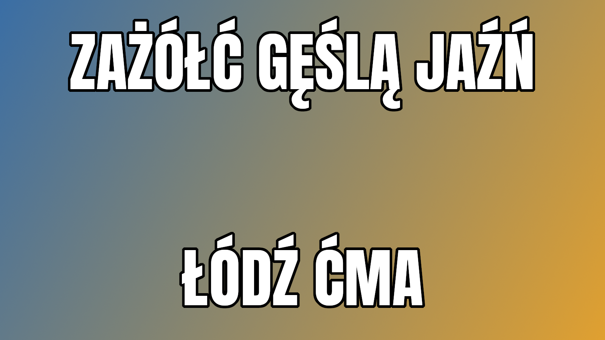
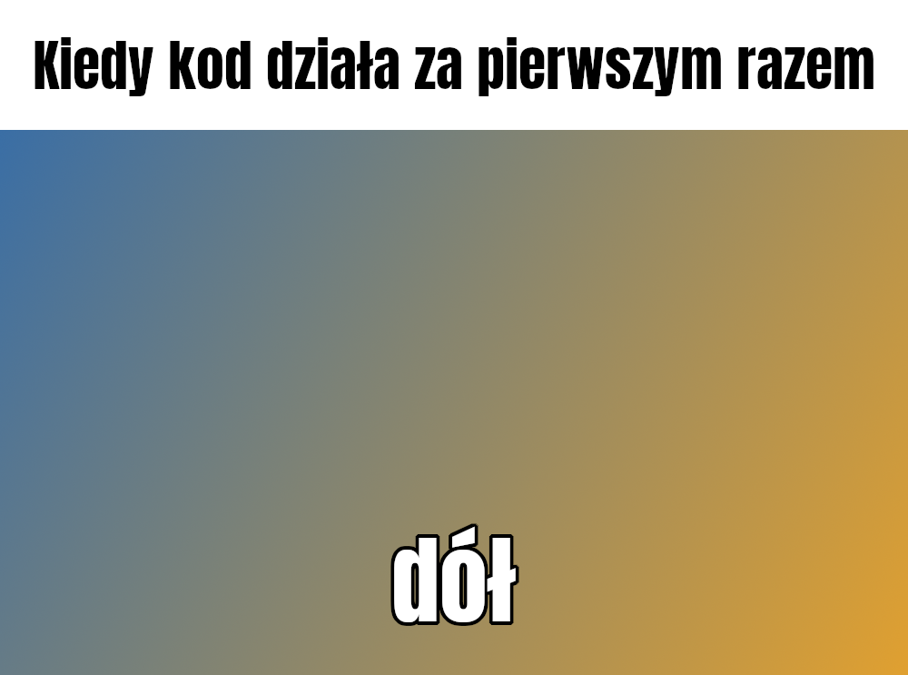

# Meme Maker – GIMP 3 plug-in

*[Polski](README.md)*

A free, open-source (GPL-3.0) plug-in that turns an ordinary photo into a meme: top and bottom text with a black outline, or the classic "white bar on top". It works fully offline: no accounts, no API keys, no paid services, no data collection. It needs nothing but GIMP 3 itself.





Tested on GIMP 3.2.6 (Windows 11).

## Language

The interface is available in **Polish and English** and follows GIMP's interface language automatically (anything that is not Polish gets English). To force a language, set the environment variable `GIMP_WTYCZKI_LANG=en` (or `pl`) before starting GIMP. GIMP caches menu labels of plug-ins, so after switching the language reinstall the plug-in (`install.ps1`) or touch `meme-maker.py` so GIMP re-reads it; the dialogs change immediately.

## Installation (Windows)

From the `gimp-wtyczki` folder (or an unpacked release package):

```powershell
powershell -ExecutionPolicy Bypass -File .\install.ps1 -Plugin meme-maker
```

The script finds the newest `%APPDATA%\GIMP\3.x` folder (force a version with `-Version 3.0`), copies the `meme-maker` folder to `plug-ins` and the Anton font to GIMP's `fonts` folder. Then restart GIMP.

Manually: copy the `meme-maker` folder so that the path becomes `%APPDATA%\GIMP\3.2\plug-ins\meme-maker\meme-maker.py`. The folder must have the same name as the `.py` file. You can check the actual location in GIMP: *Edit → Preferences → Folders → Plug-ins*. The font does not have to be copied by hand: if Anton is not installed, the plug-in copies the bundled file to GIMP's fonts folder on first use.

Linux/macOS: `~/.config/GIMP/3.x/plug-ins/meme-maker/`; the file must be executable (`chmod +x meme-maker.py`).

## Usage

1. Open a photo.
2. **Filters → Memes → Create meme…**
3. Type the top and/or bottom text (Enter = new line) and click OK.
4. Optionally **Filters → Memes → Export meme…** to save a JPG/PNG.

Everything is **one undo step**: a single Ctrl+Z removes the meme. The original photo layer stays untouched. The text goes into a layer group called "Mem": each block is a text layer with a separate outline layer below it. Your selection is preserved.

### "Create meme" dialog options

| Field | Description | Default |
|---|---|---|
| Top / bottom text | Multi-line; an empty field = no text | – |
| Font | *Automatic* or *Selected below* | Automatic |
| Custom font | Used in the "Selected below" mode | – |
| Font size (px) | 0 = auto, proportional to the width (≈ 1/9 of the width) | 0 |
| Text color | | white |
| Outline color | | black |
| Outline thickness | % of the font size; 0 = no outline | 4 % |
| UPPERCASE | Works with Polish letters too (ą → Ą) | on |
| Alignment | center / left / right | center |
| Margin | % of the photo's shorter side | 4 % |
| Text bar | None / above the photo (top text) / below the photo (bottom text) | None |
| Bar color | White (black text) or black (white text) | White |
| Editable text layers | Off: the meme is flattened to a single "Mem" layer above the photo | on |
| Preview on the image | The meme appears on the photo as you change settings (no undo-history entries); Cancel removes the preview | on |

**Automatic font order:** Anton → Impact (if installed) → Arial Black → Sans-serif Bold.

**Auto-fit.** If the text does not fit the photo width (minus margins) it is wrapped into several lines. If it still does not fit (a very long word or a block taller than 30 % of the photo) the font is reduced in 10 % steps down to 8 px.

**Bar.** The canvas is extended by a bar, the photo is shifted (pixels unchanged) and the text from that side goes into the bar in a contrasting color without an outline. The text from the other side stays on the photo in the usual meme style.

### Export

*Filters → Memes → Export meme…* saves the visible image as **JPG** (quality 1–100, default 90) or **PNG** (compression 0–9). The default name is `<photo-name>-mem.jpg` next to the original. Export works on a copy, so the image in GIMP stays unchanged. If the extension does not match the format, the plug-in corrects it.

## Calling from a script (Python, PDB)

```python
proc = Gimp.get_pdb().lookup_procedure("python-fu-meme-maker")
cfg = proc.create_config()
cfg.set_property("run-mode", Gimp.RunMode.NONINTERACTIVE)
cfg.set_property("image", image)
cfg.set_core_object_array("drawables", image.get_selected_drawables())
cfg.set_property("top-text", "When the code works")
cfg.set_property("bottom-text", "on the first try")
proc.run(cfg)
```

Argument ids: `top-text`, `bottom-text`, `font-mode` (`auto`/`custom`), `font`, `font-size`, `text-color`, `outline-color`, `outline-percent`, `uppercase`, `align` (`center`/`left`/`right`), `margin-percent`, `bar` (`none`/`top`/`bottom`), `bar-color` (`white`/`black`), `editable`, `live-preview` (dialog only). Export: `python-fu-meme-export` with `file`, `format` (`jpg`/`png`), `quality`, `png-compression`.

## Tests

- Pure functions (font choice, wrapping, fitting, margins), no GIMP needed: `python -m pytest tests`
- Integration test in a real GIMP (headless, the plug-in must be installed), run from the `gimp-wtyczki` folder:
  ```
  "%LOCALAPPDATA%\Programs\GIMP 3\bin\gimp-console-3.2.exe" -i --batch-interpreter python-fu-eval -b "exec(open(r'tests/gimp_meme_integration.py', encoding='utf-8').read())" --quit
  ```

## Known limitations

- **The outline does not follow text edits.** If you change the text of a text layer with the Text tool, the outline layer stays old. Undo the meme (Ctrl+Z) and run the plug-in again, or fix the outline by hand.
- **Very small image + very long text.** Below 8 px the font is no longer reduced. On a 120×80 px image long text will not fit and blocks may overlap; GIMP shows a warning.
- **Space around letters.** A text layer has internal spacing from the font metrics, so the visual margin may be slightly larger than set.
- **Default colors in GIMP 3.2.** GIMP does not pass default values of color arguments (a fully transparent color arrives). The plug-in treats a transparent color as "unset" and uses white/black.
- **Arial Black** is sometimes invisible to GIMP even when installed in Windows; the choice then goes straight to Sans-serif Bold.
- Inactive fields (e.g. *Custom font* in automatic mode) are greyed out, not hidden.

## Licenses

- Plug-in code: **GPL-3.0**, full text in [`LICENSE`](LICENSE).
- The **Anton** font (`fonts/Anton-Regular.ttf`), © 2020 The Anton Project Authors, under the **SIL Open Font License 1.1** ([`fonts/OFL.txt`](fonts/OFL.txt)). It may be redistributed with the plug-in; the OFL license must be included and the font must not be sold on its own.
- **Impact** is a commercial font. The plug-in does **not** bundle it; it only uses it if it is already installed.
