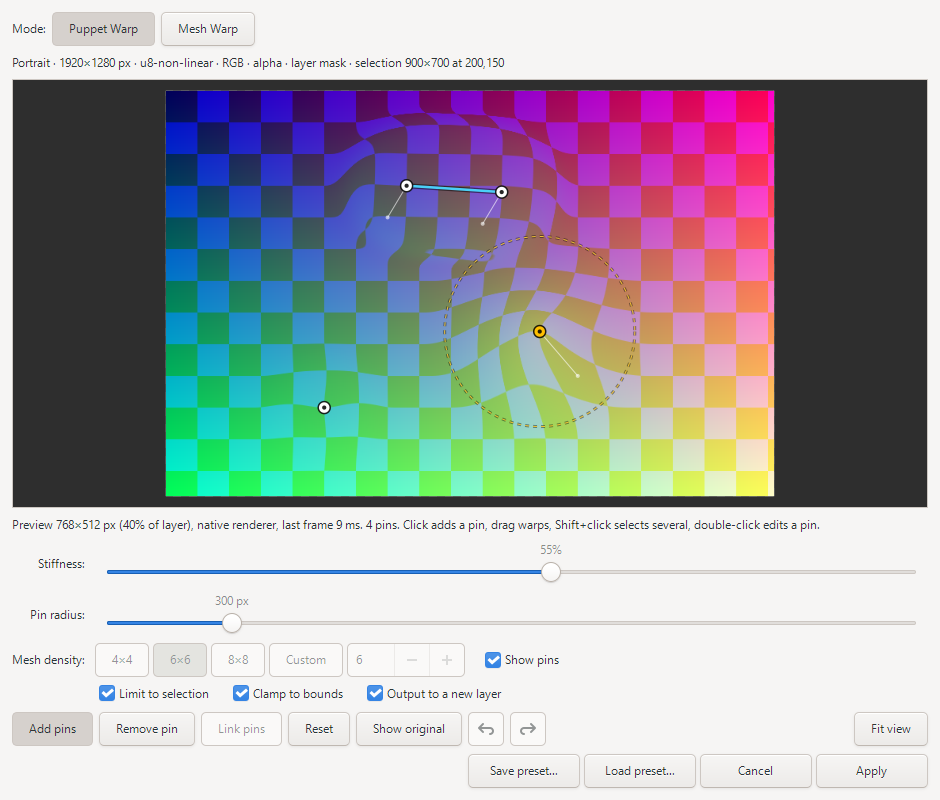

#  WarpForge

Puppet Warp and Mesh Warp for **GIMP 3**: deform a layer with control pins or a
mesh, with a live preview. · [Polski](README.pl.md) ·
[Download](https://github.com/Gimp3-plugins/Gimp3-plugins/releases) (`warpforge-v*` releases)

> **Version 1.0.0rc2 – release candidate.** All MVP features are in. The
> automated tests pass on Windows (with a headless GIMP 3.2.6) and on Linux
> inside Flathub's GIMP 3.2.8 (installed by the ZIP's installer and as a
> Flatpak extension). Not yet confirmed by hand in GIMP's interface – see
> [Testing status](#testing-status). The effect is re-editable but **not** a
> native GIMP non-destructive filter: GIMP 3.2 does not allow that for a warp
> from a plug-in – see [Non-destructive editing](#non-destructive-editing).



## Features

Working now:

- `Filters › Distorts › WarpForge…` and `WarpForge: Puppet/Mesh Warp` in the
  Layers panel context menu.
- Reads the active layer (8-bit, 16-bit, 32-bit float; RGB or grayscale), its
  selection and layer mask.
- Preview downscaled by GEGL to at most 1024 px on the longer side.
- Preview zoom (scroll) and pan (middle-drag or Space+drag); Space shows the original.
- **Puppet Warp**: click to add pins, drag them to deform the image.
  - A pin lands exactly where it is dragged; beyond its *radius* the image
    does not move. The radius grows automatically to at least twice the
    distance a pin is dragged, which prevents the image from folding over
    itself in typical edits.
  - *Stiffness* 0% lets regions stretch and shrink, 100% only moves and
    rotates them (Moving Least Squares, similarity ↔ rigid).
  - Per-pin radius and weight (double-click a pin), restore a pin's position,
    remove pins, select several with Shift+click or Ctrl+A.
  - **Rigid segments**: *Link pins* (Ctrl+L) joins the selected pins; they
    move together and the segment between them keeps its length and angle.
  - Adding a pin to an already warped image does not make it jump.
- **Mesh Warp**: 4×4, 6×6, 8×8 or custom (2–32) meshes; drag vertices.
  - Corners stay put and border vertices slide along their border, so the
    warped layer always fills its bounds.
  - Drags that would fold the mesh are stopped at the last valid position.
  - *Clamp to bounds* keeps inner vertices inside the layer.
- Live preview rendered off the UI thread (with the native renderer, a
  1024 px preview takes about 10–15 ms per frame with 30 pins and 15–20 ms
  with an 8×8 mesh).
- Undo/redo inside the dialog per finished gesture (Ctrl+Z, Ctrl+Shift+Z /
  Ctrl+Y), kept separately for pins and for the mesh.
- Apply renders at full resolution in float precision, tile by tile, with a
  progress bar; the whole commit is **one GIMP undo step**.
- By default the result goes to a new layer `<name> (WarpForge)` above the
  original, which is hidden but untouched. Untick *Output to a new layer* to
  warp in place.
- *Limit to selection* restricts the change to the selection; otherwise an
  existing selection is ignored and restored afterwards.
- Clear errors for no layer, several layers, groups, locked layers.
- **Re-editable effects**: the parameters are stored with the warped layer
  (saved in XCF); open WarpForge on that layer to change the pins or the
  mesh. Show/hide and remove the effect from the Layers menu.
- **Presets**: save and load the pins or the mesh as JSON (schema in
  `data/schemas/`), with validation, versioning and scaling to another layer
  size.

Not planned for 1.0: animation, automatic skeletons, AI fill, online preset
sharing, several images at once, vector text layers (text is warped as pixels).

## Requirements

- GIMP **3.0 or newer** (developed and tested on 3.2.6).
- Nothing else: WarpForge uses only what GIMP ships (Python 3, PyGObject, GTK 3,
  GEGL) plus its own native library, included in the platform ZIP.
- Without the native library it falls back to a pure-Python renderer: it works,
  but the preview is limited to 320 px and applying is much slower.

## Install

### From the ZIP (recommended)

Download `warpforge-<version>-<platform>.zip` for your system
(`windows-x86_64` or `linux-x86_64`) from the
[releases tagged `warpforge-v*`](https://github.com/Gimp3-plugins/Gimp3-plugins/releases), unpack it anywhere, and run the
installer next to the `warpforge` folder. It copies the plug-in into the
newest GIMP 3.x profile (start GIMP 3 once beforehand so the profile exists):

```powershell
powershell -ExecutionPolicy Bypass -File install.ps1
```

```sh
./install.sh             # Linux or macOS; add --flatpak for Flatpak GIMP
```

Both accept `-Uninstall` / `--uninstall`; `install.ps1 -GimpVersion 3.0`
picks a specific profile. Restart GIMP afterwards.

### By hand

1. Unpack the ZIP's `warpforge` folder into your GIMP plug-ins folder so that
   you get `plug-ins/warpforge/warpforge.py`:
   - Windows: `%APPDATA%\GIMP\3.2\plug-ins\`
   - Linux: `~/.config/GIMP/3.2/plug-ins/`
   - Linux Flatpak (Flathub GIMP 3.2): also `~/.config/GIMP/3.2/plug-ins/`; older
     Flatpak builds used `~/.var/app/org.gimp.GIMP/config/GIMP/3.x/plug-ins/`
   - macOS: `~/Library/Application Support/GIMP/3.2/plug-ins/`

   (Use your GIMP version, e.g. `3.0` instead of `3.2`.)
2. On Linux/macOS make sure `warpforge.py` is executable: `chmod +x warpforge.py`.
3. Restart GIMP.

Updating: install over the old version (the installers replace the folder).
GIMP notices new menu entries only when `warpforge.py` changes, which an
update does.

### From source

```sh
cargo build --release --manifest-path src/warpforge/native/Cargo.toml
python tools/install.py            # copies into the newest GIMP 3.x profile
python tools/install.py --flatpak  # Flatpak GIMP on Linux
python tools/install.py --uninstall
```

## Usage

1. Select one pixel layer.
2. Open `Filters › Distorts › WarpForge…` (or right-click the layer).
3. **Puppet Warp** (default): click to place pins on parts that should stay
   or move, then drag pins. Or choose **Mesh Warp** and a mesh density, then
   drag the mesh vertices.
4. Click **Apply** (or press Enter). Only the active mode's warp is applied.

| Input | Action |
|---|---|
| Click on the image (Puppet) | Add a pin (when *Add pins* is on) |
| Click / Shift+click a pin | Select it / add it to or remove it from the selection |
| Drag a pin or a vertex | Deform |
| Double-click a pin | Pin settings: radius, weight, restore, remove, unlink |
| Delete / Backspace | Remove the selected pins |
| Ctrl+A, Ctrl+L | Select all pins; link / unlink the selected pins |
| *Pin radius* slider | Radius of new pins and of the selected pins |
| Reset | Puppet: restore all pin positions, press again to remove all pins. Mesh: regular grid |
| Ctrl+Z / Ctrl+Shift+Z, Ctrl+Y | Undo / redo inside the dialog |
| Save preset… / Load preset… | Write or read the current mode's pins or mesh as JSON |
| Scroll | Zoom the preview around the pointer |
| Middle-drag, Space+drag | Pan |
| Space (hold) / Show original | Show the original |
| Enter | Apply |
| Esc | Cancel |

## Non-destructive editing

GIMP 3.2 has non-destructive filters, but a plug-in can only attach GEGL
operations from GIMP's allow-list, and the ones that could carry a warp
(`gegl:map-absolute`, or `gegl:displace` with map layers) are either not on
it or silently refused (details and a re-runnable probe: `NOTES.md`). So
WarpForge does the next best thing:

- **Apply** puts the result on a new layer `<name> (WarpForge)`; the original
  stays untouched, hidden below it.
- The warped layer remembers its pins or mesh (saved in XCF). Select it and
  open WarpForge (or **Layers menu › WarpForge: Edit Effect…**) to edit them;
  Apply re-renders the same layer from the original.
- **WarpForge: Show/Hide Effect** swaps the warped layer and the original.
- **WarpForge: Remove Effect** deletes the warped layer and shows the original.
- Every step is one GIMP undo step.

What this is not: the warp does not appear in GIMP's own filter list, it
does not update by itself when you paint on the original (re-open and Apply),
and a warp applied in place (*Output to a new layer* off) cannot be
re-edited – only its parameters are kept.

## Sample images

`data/samples/` has two test images made by `tools/make_samples.py`:
`figure-1000.png` (a jointed figure on transparency – put pins on the joints)
and `grid-1000.png` (a checker grid that shows any kink). `python
tools/make_samples.py --large` also writes 4000 and 8000 px grids to
`dist/samples/` for performance checks.

## Limitations

- Not a native GIMP non-destructive filter; see [Non-destructive editing](#non-destructive-editing).
- Opening WarpForge on a WarpForge layer always edits its effect; to warp a
  warped layer again, duplicate it first (*Layer › Duplicate*), or warp in place.
- The layer mask is kept as is, not warped together with the pixels.
- Puppet Warp folds the image if you drag a pin across another pin, or if a
  rigid segment runs right next to a pin that moves differently: these are
  contradictory constraints. Content pulled in from outside the layer is
  transparent.
- The schema's per-pin `pinned_rotation` / `pinned_scale` flags are stored
  but have no effect yet.
- Works on one layer at a time; layer groups and locked layers are rejected.
- Applying cannot be cancelled half-way; the dialog's Cancel discards the edits.
- Text layers: the warp will apply to a rasterized copy of the pixels (text
  becomes a normal layer).
- The UI is GTK 3, because GIMP 3 itself is GTK 3.

## Testing status

| Check | Status |
|---|---|
| Unit tests (Python + Rust): geometry, MLS, mesh, presets, tiling, backend parity, speed, leaks | Pass (Windows; CI also runs Ubuntu) |
| Headless GIMP 3.2.6 (`tools/run_gimp_smoke.py`): reading, preview, commit in 8-bit and 16-bit float, selection, mask, effects, XCF round trip, PDB procedures | Pass (Windows) |
| Dialog builds and renders with GIMP's own Python/GTK (`tools/render_dialog_screenshot.py`) | Pass (Windows) |
| Interactive use in GIMP's UI ([manual test list](tests/gimp/MANUAL_TESTS.md)) | **Not done yet** |
| Linux, headless GIMP 3.2.8 from Flathub, in CI (`.github/workflows/warpforge-linux-gimp.yml`): the same smoke test with the plug-in installed by `install.sh --flatpak` from the release ZIP, and again as a Flatpak extension built from the manifest | Pass |
| Linux distribution packages of GIMP 3 (not Flatpak) | Not tested (same code and `.so`; expected to work) |
| macOS | Not built or tested |

## Reporting bugs

Please [open an issue](https://github.com/Gimp3-plugins/Gimp3-plugins/issues/new?template=warpforge-bug.yml) with the
*WarpForge: bug report* template and include:

1. WarpForge version (Help › Procedure Browser › `plug-in-warpforge`, or the
   ZIP name), GIMP version and how it was installed (installer, Flatpak,
   Snap…), operating system.
2. What you did, what you expected, what happened; the image's precision
   (Image › Precision) and layer size.
3. A log. GIMP gives plug-ins no console on Windows, so set a log file before
   starting GIMP:

   ```powershell
   $env:WARPFORGE_LOG_FILE = "$env:TEMP\warpforge.log"; $env:WARPFORGE_LOG_LEVEL = "DEBUG"; & "$env:LOCALAPPDATA\Programs\GIMP 3\bin\gimp-3.exe"
   ```

   ```sh
   WARPFORGE_LOG_FILE=/tmp/warpforge.log WARPFORGE_LOG_LEVEL=DEBUG gimp
   ```

4. If possible, a preset (*Save preset…*) that reproduces the problem.

## Development

```sh
python -m venv .venv && .venv/Scripts/pip install -e .[dev]   # Linux: .venv/bin/pip
.venv/Scripts/ruff check .
.venv/Scripts/mypy
.venv/Scripts/pytest
python tools/install.py --dev         # GIMP runs the plug-in straight from src/
python tools/run_gimp_smoke.py        # gimp_bridge and effect tests inside headless GIMP
python tools/run_gimp_smoke.py --script tests/gimp/nde_probe.py  # can GIMP do a warp NDE yet?
python tools/package.py               # dist/warpforge-<version>-<platform>.zip
python tools/benchmark.py             # full-resolution timings: 1000, 4000, 8000 px
python tools/make_samples.py --large  # sample images
```

Releasing: bump the version in `src/warpforge/__init__.py`, `pyproject.toml`,
`src/warpforge/native/Cargo.toml` and `meson.build`, add a `CHANGELOG.md`
entry, then push a tag `warpforge-v<version>`. The repository's
`.github/workflows/warpforge-release.yml` tests, builds the Linux and Windows
ZIPs and publishes a GitHub release with them (marked pre-release for `rc`
versions). `.github/workflows/warpforge-ci.yml` runs the checks on every push
that touches `warpforge/`.

Native kernels (Rust, C ABI, loaded with `ctypes`):

```sh
cd src/warpforge/native && cargo test && cargo build --release
```

Layout:

- `src/warpforge/gimp_bridge.py` – the **only** module that calls GIMP/GEGL.
- `state.py` – data model and the `WarpSession` object (no global state).
- `mesh.py`, `geometry.py` – mesh model, constraints, triangulation.
- `puppet.py` – pins, rigid groups and the reference MLS deformation.
- `presets.py` – preset JSON, validation, versioning; also the stored-effect format.
- `render.py` – backend interface, pure-Python backend, tiled full-resolution render.
- `native_backend.py` + `native/` – Rust kernels (same algorithms, multi-threaded) via `ctypes`.
- `preview.py` – background preview worker; `history.py` – in-dialog undo.
- `dialog.py`, `canvas.py`, `editing.py` – GTK 3 UI, the pin tool and the mesh tool.
- `plugin.py` – entry point, applying, stored effects (edit / show-hide / remove);
  `packaging/plug-in/warpforge.py` – GIMP launcher.
- `NOTES.md` – verified GIMP 3 API findings and pitfalls.
- `tests/gimp/MANUAL_TESTS.md` – checks that need a person in front of GIMP.

## License

GPL-3.0-or-later. See [LICENSE](LICENSE).
