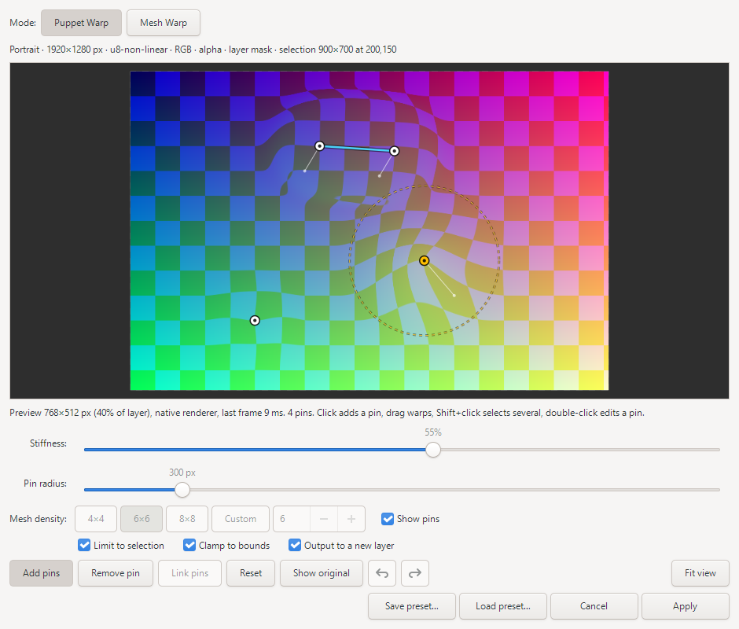

#  WarpForge

Puppet Warp i Mesh Warp dla **GIMP-a 3**: deformowanie warstwy pinami albo
siatką, z podglądem na żywo. · [English](README.md) ·
[Pobierz](https://github.com/Gimp3-plugins/Gimp3-plugins/releases) (wydania `warpforge-v*`)

> **Wersja 1.0.0rc2 – wydanie kandydujące.** Wszystkie funkcje są gotowe.
> Testy automatyczne przechodzą na Windowsie (w GIMP-ie 3.2.6 bez okna) i na
> Linuksie w GIMP-ie 3.2.8 z Flathuba (instalacja z ZIP-a i rozszerzenie
> Flatpak). Obsługa w interfejsie GIMP-a nie została jeszcze sprawdzona
> ręcznie. Efekt można ponownie edytować, ale **nie** jest to
> natywny filtr nieniszczący GIMP-a – GIMP 3.2 na to nie pozwala (szczegóły
> niżej).



## Co potrafi

- **Puppet Warp:** kliknięcie dodaje pin, przeciągnięcie deformuje obraz.
  Pin trafia dokładnie tam, gdzie go upuścisz; poza jego zasięgiem obraz się
  nie rusza. *Sztywność* 0% pozwala fragmentom się rozciągać, 100% tylko je
  przesuwa i obraca. Promień i waga pinu (dwuklik na pinie), zaznaczanie
  wielu pinów (Shift+klik, Ctrl+A), **sztywne segmenty** (*Link pins*,
  Ctrl+L): połączone piny poruszają się razem.
- **Mesh Warp:** siatka 4×4, 6×6, 8×8 albo dowolna 2–32; przeciąganie
  wierzchołków, ochrona przed zawinięciem siatki, *Clamp to bounds*.
- Podgląd do 1024 px liczony w tle (ok. 10–20 ms na klatkę), cofanie w oknie
  (Ctrl+Z / Ctrl+Shift+Z), zoom kółkiem, przesuwanie środkowym przyciskiem
  albo Spacja+przeciąganie, Spacja pokazuje oryginał.
- **Zastosuj** liczy w pełnej rozdzielczości i precyzji float, z paskiem
  postępu, jako **jeden krok cofania**. Domyślnie wynik trafia na nową
  warstwę, a oryginał zostaje nietknięty (ukryty).
- **Ponowna edycja:** warstwa z wynikiem pamięta piny lub siatkę (także w
  XCF). Otwórz na niej WarpForge, żeby je zmienić.
- **Presety JSON:** zapis i wczytanie pinów lub siatki, ze sprawdzaniem
  poprawności, wersjonowaniem i skalowaniem do innej wielkości warstwy.

## Instalacja

Wymagany GIMP **3.0 lub nowszy** (testowane na 3.2.6). Nic więcej nie trzeba
instalować.

1. Uruchom raz GIMP-a 3 (żeby powstał profil), potem go zamknij.
2. Pobierz `warpforge-<wersja>-windows-x86_64.zip` albo
   `warpforge-<wersja>-linux-x86_64.zip` z
   [wydań `warpforge-v*`](https://github.com/Gimp3-plugins/Gimp3-plugins/releases)
   i rozpakuj w dowolnym miejscu.
3. Uruchom instalator obok folderu `warpforge`:

   ```powershell
   powershell -ExecutionPolicy Bypass -File install.ps1
   ```

   ```sh
   ./install.sh             # Linux lub macOS; --flatpak dla GIMP-a z Flatpaka
   ```

   Odinstalowanie: `-Uninstall` / `--uninstall`.
4. Uruchom GIMP-a.

## Gdzie jest w menu

- **Filtry › Zniekształcenia › WarpForge…** (*Filters › Distorts*)
- Prawy przycisk na warstwie w panelu Warstwy: *WarpForge: Puppet/Mesh Warp*,
  *Edit Effect…*, *Show/Hide Effect*, *Remove Effect*.
- Albo **/** (wyszukiwarka akcji) i wpisz `WarpForge`.

Pozycje są aktywne, gdy otwarty jest obraz i zaznaczona dokładnie jedna
warstwa.

## Obsługa

| Akcja | Działanie |
|---|---|
| Klik na obrazie (Puppet) | Dodaje pin (gdy *Add pins* jest włączone) |
| Klik / Shift+klik na pinie | Zaznacza / dodaje lub usuwa z zaznaczenia |
| Przeciągnięcie pinu lub wierzchołka | Deformacja |
| Dwuklik na pinie | Promień, waga, przywróć pozycję, usuń, rozłącz |
| Delete / Backspace | Usuwa zaznaczone piny |
| Ctrl+A, Ctrl+L | Zaznacza wszystkie piny; łączy / rozłącza zaznaczone |
| Reset | Puppet: przywraca pozycje pinów, drugi raz usuwa piny. Mesh: siatka regularna |
| Ctrl+Z / Ctrl+Shift+Z, Ctrl+Y | Cofnij / ponów w oknie |
| Kółko, środkowy przycisk, Spacja | Zoom, przesuwanie, podgląd oryginału |
| Enter / Esc | Zastosuj / Anuluj |

## Edycja nieniszcząca – jak to naprawdę działa

GIMP 3.2 ma filtry nieniszczące, ale wtyczka może dodać tylko operacje z
listy dozwolonych przez GIMP, a te, które mogłyby nieść deformację, albo są
poza listą, albo GIMP je po cichu odrzuca (szczegóły w [NOTES.md](NOTES.md)).
Dlatego WarpForge:

- zapisuje wynik na nowej warstwie `<nazwa> (WarpForge)`, a oryginał zostaje
  nietknięty i ukryty pod spodem;
- zapamiętuje piny lub siatkę w warstwie z wynikiem (zapisywane w XCF) –
  otwórz WarpForge na tej warstwie, żeby edytować efekt;
- *WarpForge: Show/Hide Effect* zamienia widoczność wyniku i oryginału,
  *WarpForge: Remove Effect* usuwa wynik i pokazuje oryginał.

Efekt nie pojawia się na liście filtrów GIMP-a i nie odświeża się sam po
malowaniu po oryginale (trzeba otworzyć efekt i kliknąć *Apply*). Deformacji
zastosowanej w miejscu nie da się edytować.

## Ograniczenia

- Maska warstwy zostaje bez zmian (nie deformuje się); warstwy tekstowe są
  deformowane jako piksele.
- Zastosowania nie da się przerwać w połowie.
- Przeciągnięcie pinu przez inny pin zawija obraz (to sprzeczne więzy).
- Bez biblioteki natywnej działa wolniejszy renderer w Pythonie (podgląd
  320 px).

## Zgłaszanie błędów

[Nowe zgłoszenie](https://github.com/Gimp3-plugins/Gimp3-plugins/issues/new?template=warpforge-bug.yml)
z szablonem *WarpForge: bug report*. Dołącz wersje (WarpForge, GIMP, system),
kroki i log. Na Windowsie GIMP nie daje wtyczkom konsoli, więc ustaw plik
logu przed uruchomieniem GIMP-a:

```powershell
$env:WARPFORGE_LOG_FILE = "$env:TEMP\warpforge.log"; $env:WARPFORGE_LOG_LEVEL = "DEBUG"; & "$env:LOCALAPPDATA\Programs\GIMP 3\bin\gimp-3.exe"
```

Szczegóły techniczne, budowanie ze źródeł i stan testów: [README.md](README.md)
(po angielsku). Licencja: GPL-3.0-or-later.
