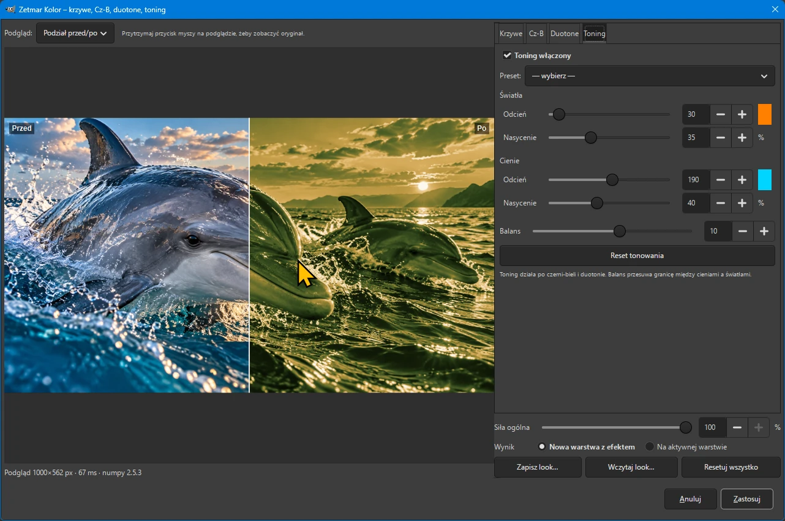

# Zetmar Color – curves, B&W, duotone, toning for GIMP 3

A **GIMP 3** plug-in (Python 3): **curves, black & white, sepia, monochrome, duotone and toning** in one window
with a before/after preview. It is a port of the *Zetmar Color* Photoshop (.8bf) plug-in, **without LUTs** –
for LUTs use the separate [LUTs (.cube)](../gimp-wtyczki/lut-cube/) plug-in. Polish and English interface.

[Polski](README.md) · [Changes](CHANGES.md)



Menu: **Filters → Zetmar → Color (curves, B&W, duotone, toning)…**

## Download

The ready package is in the
[`zetmar-kolor-v1.0.0`](https://github.com/Gimp3-plugins/Gimp3-plugins/releases/tag/zetmar-kolor-v1.0.0) release:

- `zetmar-kolor-v1.0.0.zip` – the plug-in with the `install.ps1` installer: unpack and run the installer,
- `zetmar-kolor-v1.0.0-manual.zip` – only the `zetmar-kolor` folder, to copy into `plug-ins` in your GIMP profile,
- `SHA256SUMS-v1.0.0.txt` – checksums.

## Installation

**Windows** (PowerShell, in the unpacked folder):

```powershell
powershell -ExecutionPolicy Bypass -File .\install.ps1
```

The script copies the plug-in to `%APPDATA%\GIMP\3.x\plug-ins\zetmar-kolor` (the newest GIMP 3 profile).
Removal: `install.ps1 -Uninstall`. Then restart GIMP.

**Manually** (also Linux): copy the `plug-ins/zetmar-kolor` folder into your user plug-ins folder
(GIMP: *Edit → Preferences → Folders → Plug-ins*); on Linux make `zetmar-kolor.py` executable.

### numpy (speed)

The plug-in computes with **numpy** when it finds it: the system one first, then `vendor/` next to the plug-in,
then `vendor/` of the **LUTs (.cube)** plug-in (if that is installed, nothing has to be copied). A 1000 px
preview then takes a few dozen milliseconds. Without numpy it falls back to pure Python – the same result,
only slower (the preview is smaller then).

## What is in the window

- **Curves**: PCHIP interpolation (no overshoot), RGB / R / G / B channels, luminosity-only mode, 8 presets
  (S-curves, matte, lift shadows, tame highlights, cross-process, negative), histogram (also logarithmic).
  Click adds a point, drag moves it, right click / Del deletes it, arrows ±1.
- **B&W**: black & white with a 6-color mixer (−200…300 %), filters (red, orange, yellow, green, blue, high
  contrast), sepia, monochrome with a chosen hue.
- **Duotone**: shadow and highlight colors, 6 color pairs, swap, midpoint, amount.
- **Toning**: highlights and shadows (hue, saturation), balance, 5 presets (classic, teal & orange, selenium,
  gold, cold).
- **Overall strength** and output to a **new layer** or **the active layer** (one undo step).
- **After / Before / Split** preview with a draggable divider; hold the mouse button to see the original.
- **Save / Load look** (`.zklook`) – the same format as the Photoshop version, so looks move both ways
  (LUT lines are ignored).

Pipeline: curves → B&W / sepia / monochrome → duotone → toning → overall strength. Works on RGB 8/16/32-bit
images and respects (soft) selections. For grayscale or indexed images it offers to convert to RGB.

## Non-interactive call

Procedure `python-fu-zetmar-kolor` (scripts, *Filters → Repeat*): `look` (`.zklook` text) or `look-file`
(a `.zklook` file), `output` (`new-layer` / `in-place`). After you apply it from the window, GIMP remembers the
settings, so Ctrl+F repeats the last look.

## Tests

See [README.md](README.md#testy). `tests/test_core.py` runs in CI; `tests/gimp_batch.py` runs inside a real
GIMP (`gimp-console`). Tested on GIMP 3.2 / Windows 11; not checked in GIMP on Linux or macOS.

## License

GNU GPL v3 or later ([LICENSE](LICENSE)). Author: Marek Zettel.
