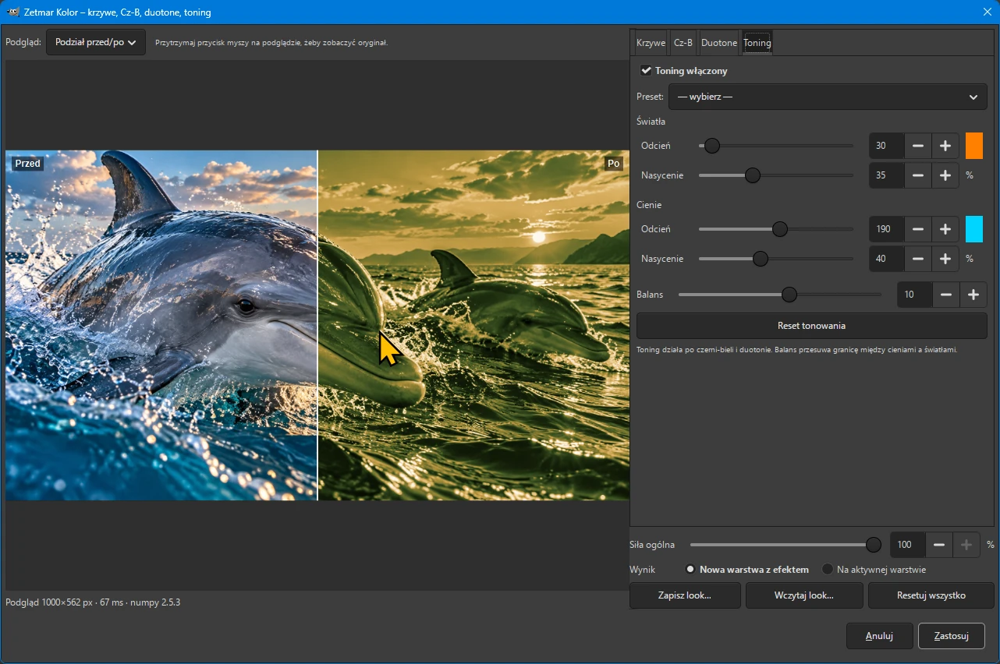

# Zetmar Kolor – krzywe, Cz-B, duotone, toning dla GIMP-a 3

Wtyczka do **GIMP 3** (Python 3): **krzywe, czerń-biel, sepia, monochromia, duotone i toning** w jednym oknie
z podglądem przed/po. To port wtyczki *Zetmar Kolor* (.8bf) dla Photoshopa, **bez LUT-ów** – do LUT-ów jest
osobna wtyczka [LUT-y (.cube)](../gimp-wtyczki/lut-cube/). Interfejs po polsku i angielsku.

[English](README.en.md) · [Zmiany](CHANGES.md)



Menu: **Filtry → Zetmar → Kolor (krzywe, Cz-B, duotone, toning)…**

## Pobieranie

Gotowa paczka jest w wydaniu
[`zetmar-kolor-v1.0.0`](https://github.com/Gimp3-plugins/Gimp3-plugins/releases/tag/zetmar-kolor-v1.0.0):

- `zetmar-kolor-v1.0.0.zip` – wtyczka z instalatorem `install.ps1`: rozpakuj i uruchom instalator,
- `zetmar-kolor-v1.0.0-manual.zip` – sam folder `zetmar-kolor` do skopiowania do `plug-ins` w profilu GIMP-a,
- `SHA256SUMS-v1.0.0.txt` – sumy kontrolne.

## Instalacja

**Windows** (PowerShell, w rozpakowanym folderze):

```powershell
powershell -ExecutionPolicy Bypass -File .\install.ps1
```

Skrypt kopiuje wtyczkę do `%APPDATA%\GIMP\3.x\plug-ins\zetmar-kolor` (najnowszy profil GIMP 3).
Usunięcie: `install.ps1 -Uninstall`. Potem uruchom GIMP-a ponownie.

**Ręcznie** (także Linux): skopiuj folder `plug-ins/zetmar-kolor` do katalogu wtyczek użytkownika
(GIMP: *Edycja → Preferencje → Katalogi → Wtyczki*); na Linuksie nadaj prawo wykonywania `zetmar-kolor.py`.

### numpy (szybkość)

Wtyczka liczy przez **numpy**, jeśli go znajdzie: najpierw systemowy, potem `vendor/` obok wtyczki, potem
`vendor/` wtyczki **LUT-y (.cube)** (jeśli jest zainstalowana, nic nie trzeba kopiować). Podgląd 1000 px liczy
się wtedy w kilkadziesiąt milisekund. Bez numpy działa czysty Python – wynik jest ten sam, ale wolniej
(podgląd jest wtedy mniejszy).

## Co jest w oknie

- **Krzywe**: interpolacja PCHIP (bez przerzutów ponad punkty), kanały RGB / R / G / B, tryb „tylko jasność”,
  8 presetów (S-krzywe, matowy, rozjaśnienie cieni, ściągnięcie świateł, cross-process, negatyw), histogram
  (także logarytmiczny). Klik dodaje punkt, przeciąganie przesuwa, prawy klik / Del usuwa, strzałki ±1.
- **Cz-B**: czerń-biel z mikserem 6 kolorów (−200…300 %), filtry (czerwony, pomarańczowy, żółty, zielony,
  niebieski, wysoki kontrast), sepia, monochromia z wyborem odcienia.
- **Duotone**: kolor cieni i świateł, 6 zestawów kolorów, zamiana kolorów, punkt środkowy, siła.
- **Toning**: światła i cienie (odcień, nasycenie), balans, 5 presetów (klasyczny, teal & orange, selenowy,
  złoty, chłodny).
- **Siła ogólna** i wynik na **nowej warstwie** albo **na aktywnej warstwie** (jeden krok cofania).
- Podgląd **Po / Przed / Podział** z przeciąganym suwakiem; przytrzymanie myszy pokazuje oryginał.
- **Zapisz / Wczytaj look** (`.zklook`) – ten sam format co w wersji dla Photoshopa, więc looki można
  przenosić w obie strony (linie LUT-a są pomijane).

Potok: krzywe → czerń-biel / sepia / monochromia → duotone → toning → siła ogólna. Wtyczka działa na obrazach
RGB 8/16/32 bit i respektuje (miękkie) zaznaczenie. Dla obrazu w skali szarości lub indeksowanego proponuje
konwersję do RGB.

## Wywołanie bez okna

Procedura `python-fu-zetmar-kolor` (skrypty, *Filtry → Powtórz*): `look` (tekst `.zklook`) albo `look-file`
(plik `.zklook`), `output` (`new-layer` / `in-place`). Po zastosowaniu w oknie GIMP zapamiętuje ustawienia,
więc Ctrl+F powtarza ostatni look.

## Testy

```powershell
& "$env:LOCALAPPDATA\Programs\GIMP 3\bin\python.exe" tests\test_core.py
```

- `tests/test_core.py` – krzywe, czerń-biel, sepia, zgodność numpy ↔ czysty Python na losowych lookach,
  zapis i odczyt looku (także plik z wersji dla Photoshopa), komplet tłumaczeń EN. Uruchamiany w CI.
- `tests/ui_snapshot.py <folder> pl|en` – zrzuty okna bez GIMP-a (okno poza ekranem).
- `tests/gimp_batch.py` – w prawdziwym GIMP-ie (`gimp-console-3.2.exe -i
  --batch-interpreter=python-fu-eval -b "exec(open(r'tests\gimp_batch.py', encoding='utf-8').read())" --quit`):
  rejestracja, nałożenie w obrazach float i 8 bit, nowa warstwa z zaznaczeniem, odczyt podglądu, błędny look.
  Wynik w pliku `ZK_TEST_OUT`.

Testowano na GIMP 3.2 / Windows 11. Wtyczka nie była sprawdzana w GIMP-ie na Linuksie ani macOS.

## Licencja

GNU GPL v3 lub nowsza ([LICENSE](LICENSE)). Autor: Marek Zettel.
