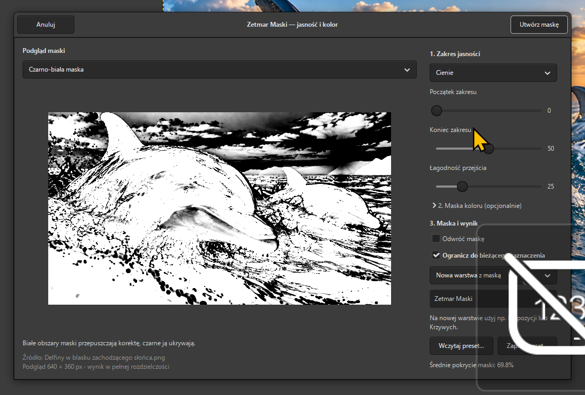

# Zetmar Maski 1.0.0 — luminosity and color masks for GIMP 3

Create masks for highlights, shadows, midtones and sampled colors. Polish user interface.
Runs offline with GIMP's Python and GTK 3; no NumPy, API keys or extra packages required.

[Polski](README.md) · [Download 1.0.0](https://github.com/Gimp3-plugins/Gimp3-plugins/releases/tag/zetmar-maski-v1.0.0)



## Install on Windows

Download **zetmar-maski-1.0.0-windows.zip** from the release above and extract it.
Run GIMP 3 once to create its user profile, close it, then run PowerShell in the extracted directory:

```powershell
powershell -ExecutionPolicy Bypass -File .\install.ps1
```

Restart GIMP. Open an RGB image, select exactly one image layer, then choose
**Filtry → Zetmar → Maski jasności i koloru…** (Filters → Zetmar).
The menu entry and dialog labels are in Polish, including on English systems.

The installer finds the newest `3.N` profile under `%APPDATA%\GIMP`.
Use `-CheckOnly` to check without installing, or `-ProfileDirectory` to select a profile.
An existing installation is backed up under `zetmar-maski-backups` in that profile.

For manual installation, copy `plug-ins/zetmar-maski` into your GIMP user plug-ins directory.
To uninstall, close GIMP and remove that plug-in folder.

## Use

- Select a preset: **Światła** (highlights), **Cienie** (shadows), **Półtony** (midtones),
  or one of the narrower ranges. Adjust the lower/upper bounds and transition softness.
- Use a monochrome mask preview, red overlay of the selected region, or original-image preview.
- Expand **Maska koloru** for optional color restriction. Enable it and click **Pobierz ze zdjęcia**,
  then click the preview to sample a color. Adjust tolerance and color softness.
- Luminosity and color masks are multiplied. Inversion happens before restricting to the image selection.
  An empty selection means the whole layer.
- Save/load mask settings as JSON presets.

| Output | Behavior |
|---|---|
| Nowa warstwa z maską | A copy of the layer with the generated mask. Apply Exposure, Curves or other adjustments to this copy. An existing copied mask is multiplied with the new mask. |
| Maska aktywnej warstwy | Add a mask to the active layer; refuses to overwrite an existing mask. |
| Kanał | An initially hidden channel at image size, accounting for layer offsets. |
| Zaznaczenie | Replace the selection without leaving a temporary channel. |

Original pixels are preserved. The result is grouped into one undo step and saved normally in XCF.
Completely transparent pixels are excluded; partial alpha stays in the layer and is not multiplied again in the mask.

## Compatibility and limits

Tested on **Windows with GIMP 3.2.8**, using 8-bit, 16-bit and 32-bit float RGB images.
Targets GIMP 3.0+ APIs; GIMP 3.0, Linux and macOS have not been tested. On Unix systems,
manual installation also requires making `zetmar-maski.py` executable.

The source is the selected layer's pixel buffer, not the merged composition. Its existing mask and
layer effects are not baked into the values used for range detection. Color masking uses RGB distance,
not object recognition. HDR and negative values are clamped only for mask calculations.

The preview is reduced to at most 640 px and may differ at fine edges from the full-size result.
Full-size masks are computed in strips with a progress indicator; large photos take time in pure Python.
This version cannot cancel computation after confirmation. Masks are static and do not update when source pixels change.
Settings are attached to mask metadata in XCF, but automatic re-editing from that metadata is not implemented.

## Development

Run `test.ps1` on Windows with a local GIMP installation for the unit and GIMP integration tests.
Run `build.ps1` to create the distributable ZIP and SHA-256 checksums under `dist`.
Core-only tests, without GIMP or third-party dependencies:

```text
python -m unittest discover -s tests -p test_*.py -v
```

Validation: 12 unit tests and 18 GIMP integration tests passed; the GTK panel was also exercised.
See [VALIDATION.md](VALIDATION.md) for details and limits, and [README.md](README.md#wywołanie-ze-skryptu)
for the noninteractive PDB example.

MIT license, copyright 2026 Marek Zettel. See [LICENSE](LICENSE).
