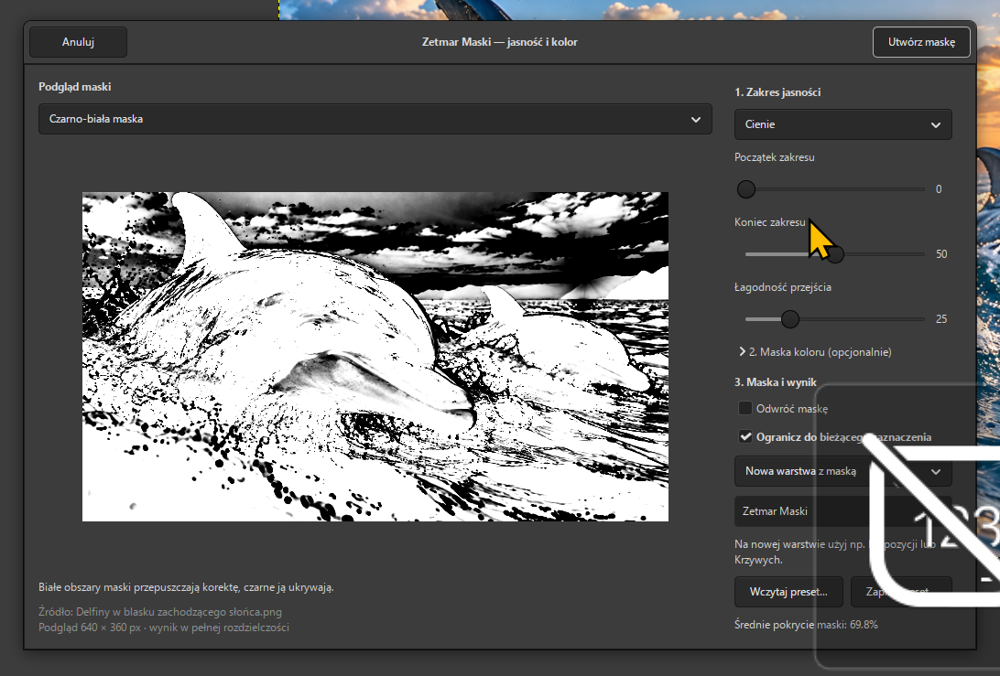

# Zetmar Maski 1.0.0 — wtyczka do GIMP 3

Tworzenie masek jasności i koloru z podglądem, bez zmieniania pikseli zdjęcia.
Interfejs po polsku. Działa offline, bez kont, kluczy API, NumPy i dodatkowych pakietów.

[English](README.en.md) · [Pobierz wersję 1.0.0](https://github.com/Gimp3-plugins/Gimp3-plugins/releases/tag/zetmar-maski-v1.0.0)



Gotową paczkę **zetmar-maski-1.0.0-windows.zip** pobierz z powyższego wydania.
Rozpakuj ją i uruchom instalator opisany poniżej. W wydaniu znajdują się również obraz demonstracyjny i sumy SHA-256.

## Instalacja na Windows

1. Uruchom raz GIMP 3, aby utworzył profil, i zamknij go.
2. Otwórz PowerShell w tym katalogu i uruchom:

   ```powershell
   powershell -ExecutionPolicy Bypass -File .\install.ps1
   ```

3. Uruchom GIMP. Otwórz zdjęcie RGB i zaznacz jedną warstwę zdjęcia.
4. Wybierz **Filtry → Zetmar → Maski jasności i koloru…**.

Instalator wykrywa najnowszy profil `3.N` w `%APPDATA%\GIMP`.
Sprawdzenie bez zmian: `install.ps1 -CheckOnly`; wybór profilu: `-ProfileDirectory C:\sciezka\profilu`.
Poprzednia instalacja trafia do `zetmar-maski-backups` w profilu. Nie wymaga administratora.

Ręcznie: skopiuj `plug-ins\zetmar-maski` do katalogu wtyczek użytkownika, tak aby powstał
`%APPDATA%\GIMP\3.2\plug-ins\zetmar-maski\zetmar-maski.py`.
Rzeczywistą ścieżkę znajdziesz w Preferencjach GIMP-a → Foldery → Wtyczki.
Odinstalowanie: przy zamkniętym GIMP-ie usuń wyłącznie folder `zetmar-maski` z `plug-ins`.

## Jak pracować

1. Wybierz preset **Światła**, **Cienie** albo **Półtony**; dostępne są również węższe zakresy.
2. Ustaw początek i koniec zakresu oraz łagodność przejścia. Wartości są podane w procentach.
   Wewnątrz zakresu maska jest biała, poza nim stopniowo zanika. Łagodność rozszerza zakres na zewnątrz.
3. Przełącz podgląd na czarno-białą maskę albo czerwoną nakładkę. Czerwona nakładka oznacza **wybrany** obszar.
4. Opcjonalnie rozwiń **Maska koloru**, włącz ograniczenie, kliknij **Pobierz ze zdjęcia**
   i wskaż kolor w podglądzie. Tolerancja poszerza zakres kolorów, a łagodność wygładza przejście.
   Jasność i kolor łączone są jako część wspólna (iloczyn masek).
5. Wybierz wynik i kliknij **Utwórz maskę**.

Na niższym ekranie użyj widocznego paska przewijania po prawej stronie panelu.

### Rodzaje wyniku

| Wynik | Zachowanie |
|---|---|
| Nowa warstwa z maską | Kopiuje aktywną warstwę i dodaje maskę. Na kopii możesz użyć Ekspozycji, Krzywych lub innych korekt. Jeśli źródło ma maskę, maska kopii jest mnożona przez nową. |
| Maska aktywnej warstwy | Dodaje maskę do aktywnej warstwy. Odmawia zastąpienia istniejącej maski. |
| Kanał | Dodaje ukryty kanał wielkości obrazu, z uwzględnieniem położenia warstwy. |
| Zaznaczenie | Zastępuje bieżące zaznaczenie obliczoną maską. Nie pozostawia pomocniczego kanału. |

Wynik zapisuje się normalnie w XCF. Wszystkie zmiany w obrazie są objęte jedną grupą cofania.
**Odwróć maskę** odwraca wynik po połączeniu jasności i koloru, a przed ograniczeniem do zaznaczenia.
Brak zaznaczenia oznacza całą warstwę. Całkowicie przezroczyste piksele zawsze dostają maskę 0;
częściowa przezroczystość pozostaje w warstwie i nie jest mnożona drugi raz w masce.

**Zapisz preset / Wczytaj preset** przenosi ustawienia maski przez plik JSON. Preset nie zawiera zdjęcia,
zaznaczenia, nazwy ani wyboru miejsca zapisu. Ustawienia maski są również dołączane do jej metadanych w XCF,
ale ta wersja nie ma polecenia automatycznej ponownej edycji maski z tych metadanych.

## Kolor i precyzja

- Obsługiwane obrazy RGB 8/16/32-bitowe; obraz nie jest konwertowany do niższej precyzji.
- Obliczenia maski na danych float, jasność percepcyjna z wagami RGB 0,2126 / 0,7152 / 0,0722.
  Zakres jasności korzysta z tablicy 4097 próbek.
- Maska koloru używa odległości RGB, a nie rozpoznawania obiektów ani semantycznego wyboru skóry czy nieba.
- Podgląd jest pomniejszony do maksymalnie 640 px; nie zastępuje oceny pełnej maski, szczególnie na drobnych krawędziach.
- Źródłem są piksele wybranej warstwy, nie połączony widok całego obrazu. Maska źródłowa i efekty warstwy
  nie są wypalane w danych używanych do wyznaczenia zakresu. Nakładka podglądu nie symuluje całej kompozycji.
- Wartości HDR powyżej 1 oraz ujemne są ograniczane tylko na potrzeby obliczenia maski; zdjęcie pozostaje bez zmian.
- Pełna maska jest liczona porcjami z paskiem postępu. Duże zdjęcia w czystym Pythonie wymagają czasu.
  Wersja 1.0 nie ma anulowania obliczeń po zatwierdzeniu.
- Maska jest statyczna: po zmianie zdjęcia źródłowego trzeba utworzyć ją ponownie.
- Sprawdzono Windows i GIMP **3.2.8**. API docelowe: GIMP 3.0+. Linux/macOS nie były testowane;
  przy instalacji ręcznej na tych systemach plik startowy musi być wykonywalny.

## Wywołanie ze skryptu

```python
proc = Gimp.get_pdb().lookup_procedure('python-fu-zetmar-maski')
cfg = proc.create_config()
cfg.set_property('run-mode', Gimp.RunMode.NONINTERACTIVE)
cfg.set_property('image', image)
cfg.set_core_object_array('drawables', [layer])
cfg.set_property('low', 0.5)
cfg.set_property('high', 1.0)
cfg.set_property('feather', 0.25)
cfg.set_property('output', 'channel')
result = proc.run(cfg)
```

Pozostałe argumenty: `invert`, `color-enabled`, `red`, `green`, `blue`, `tolerance`,
`color-softness`, `selection`, `name`. Liczby w zakresie 0–1; `low <= high`.
`output`: `new-layer`, `layer-mask`, `channel`, `selection`.

## Weryfikacja i budowanie

```powershell
.\test.ps1
.\build.ps1
```

`test.ps1` używa Pythona i GIMP-a z `%LOCALAPPDATA%\Programs\GIMP 3\bin` (zmiana: `-GimpBin`).
Testy GIMP działają w osobnym profilu `work\test-profile-headless` i na sztucznych obrazach.
Raport: `work\integration.json`. Osobny test interfejsu: `tests\run-ui.ps1` (wymaga zamknięcia okna testowego).
Przebieg i wyniki opisano w `VALIDATION.md`. Paczka dystrybucyjna powstaje w `dist`.

## Pliki

- `zm_core.py`: obliczenia, presety i walidacja, bez zależności od GIMP-a.
- `zm_gimp.py`: bufory GEGL, maski, kanały, zaznaczenia i grupa cofania.
- `zm_ui.py`: okno GTK 3 i podgląd.
- `zetmar-maski.py`: rejestracja procedury i argumentów GIMP 3.

Licencja MIT — zobacz `LICENSE`. Autor: Marek Zettel.

Dokumentacja API wykorzystana przy implementacji:
[Python plug-ins](https://developer.gimp.org/resource/writing-a-plug-in/tutorial-python/),
[Drawable.get_buffer](https://developer.gimp.org/api/3.0/libgimp/method.Drawable.get_buffer.html),
[Channel](https://developer.gimp.org/api/3.0/libgimp/class.Channel.html).
